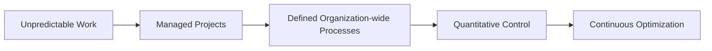
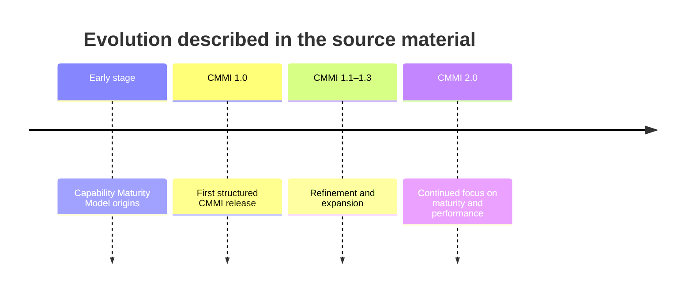
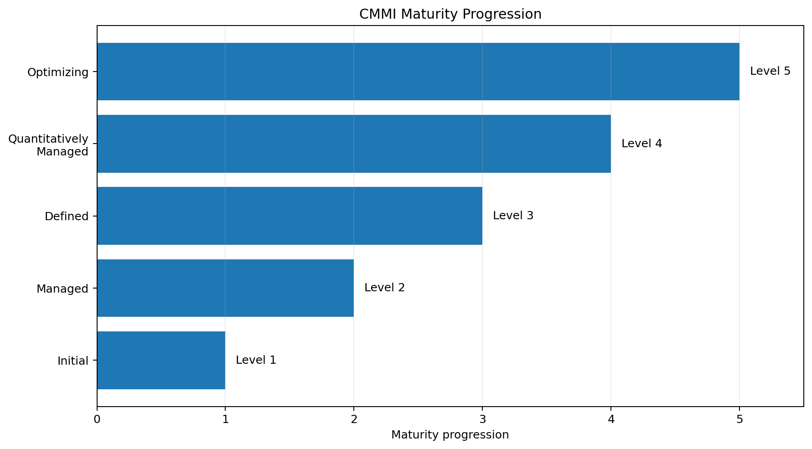
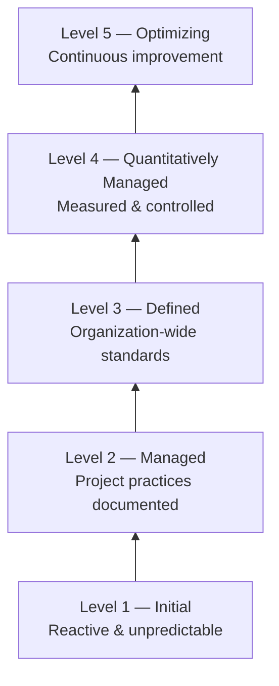
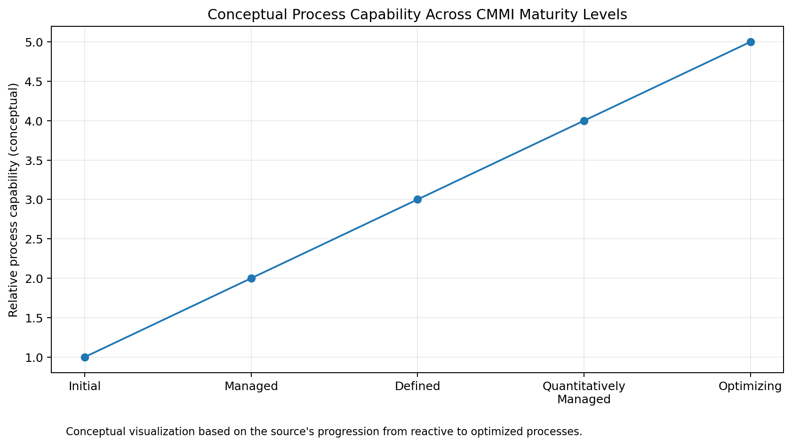
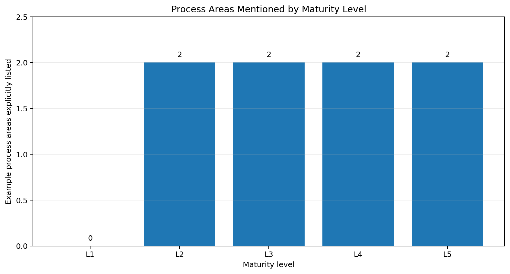
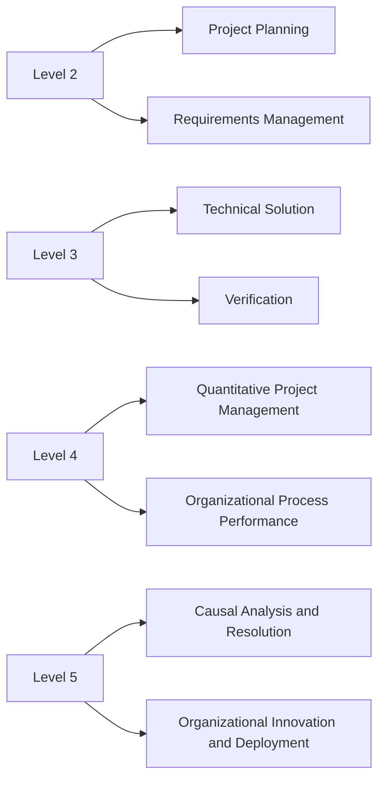
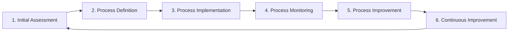
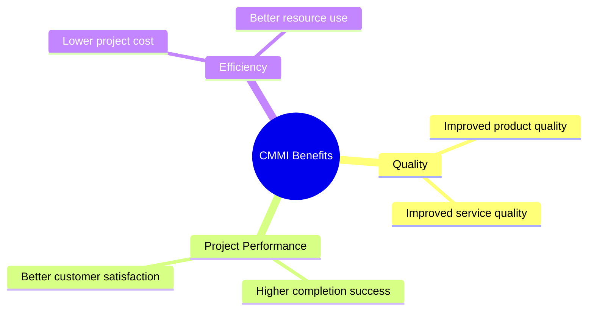

# CMMI Process Improvement Framework

<p align="center">
  A visual, source-grounded study of the <strong>Capability Maturity Model Integration (CMMI)</strong>,
  covering its evolution, maturity levels, representative process areas, implementation cycle,
  and organizational benefits.
</p>

<p align="center">
  
  
  
  
</p>


## Overview

CMMI is presented here as a structured process-improvement framework that helps organizations
move from unpredictable, reactive practices toward measurable, controlled, and continuously
improving processes.

The repository reorganizes the source material into a public-facing technical reference rather
than reproducing the assignment document.

### What this repository covers

- Introduction and purpose of CMMI
- Evolution of the framework
- Five maturity levels
- Representative process areas by maturity level
- CMM versus CMMI
- CMMI implementation process
- Key organizational benefits
- Reproducible data tables and visualizations

## 1. CMMI at a Glance

CMMI provides a roadmap for improving organizational processes. In the source material,
its purpose is associated with reducing risk, improving performance, increasing quality,
reducing project delays, and improving resource management.



The central idea is progression: process maturity develops through increasingly disciplined,
measurable, and improvement-oriented practices.

---

## 2. Evolution of CMMI

The source describes a progression from the earlier Capability Maturity Model toward a broader
CMMI framework that covers more than software development alone.



> This timeline intentionally reflects the versions named in the source material rather than
> attempting to provide a current-version history.

---

## 3. Five Maturity Levels



| Level | Maturity level | Main idea |
|---:|---|---|
| 1 | **Initial** | Processes are unpredictable, reactive, and heavily dependent on individual effort. |
| 2 | **Managed** | Basic project-management practices are established and documented. |
| 3 | **Defined** | Processes are standardized across the organization and managed proactively. |
| 4 | **Quantitatively Managed** | Statistical and quantitative methods are used to control performance. |
| 5 | **Optimizing** | Continuous improvement, innovation, and proactive prevention drive optimization. |

### Maturity ladder





The second chart is **conceptual**, not a measured dataset. It visualizes the qualitative
progression described in the source: increasing maturity corresponds to increasingly controlled,
predictable, and improvement-oriented processes.

---

## 4. Representative Process Areas

The source gives examples of process areas associated with different maturity levels.





The CSV file [`data/process_areas_by_level.csv`](data/process_areas_by_level.csv) keeps these
examples machine-readable.

---

## 5. CMM vs. CMMI

According to the source, CMM was initially focused on software development, while CMMI expanded
the scope by integrating additional disciplines such as systems engineering, service delivery,
and product development.

| Dimension | CMM | CMMI |
|---|---|---|
| Original emphasis | Software development | Broader integrated process improvement |
| Scope | Narrower | Multiple disciplines |
| Improvement model | Maturity-focused | Staged and continuous improvement paths |
| Organizational use | Software-process maturity | Integrated organizational process improvement |

---

## 6. CMMI Implementation Process

The source presents CMMI implementation as an iterative improvement cycle:



### Stage-by-stage interpretation

1. **Initial Assessment** — understand current capability and identify improvement goals.
2. **Process Definition** — establish standardized processes and performance metrics.
3. **Process Implementation** — deploy the processes across the organization.
4. **Process Monitoring** — measure performance and track progress.
5. **Process Improvement** — use feedback and data to improve the processes.
6. **Continuous Improvement** — sustain the improvement cycle over time.

---

## 7. Key Benefits

The source highlights three main benefit categories:



These benefits are framed as outcomes of disciplined, measurable, and continuously improving
processes.

---

## 8. Core Takeaway

CMMI can be understood as a maturity journey:

**reactive work → managed projects → standardized processes → quantitative control → continuous optimization**

The framework emphasizes that sustainable organizational improvement depends not only on
technical skill, but also on process discipline, measurement, feedback, and systematic learning.

---

## Reproducing the Visualizations

Create a Python environment and install the dependencies:

```bash
python -m venv .venv
```

```bash
# Linux / macOS
source .venv/bin/activate

# Windows PowerShell
.venv\Scripts\Activate.ps1
```

```bash
pip install -r requirements.txt
python scripts/generate_visuals.py
```

The charts will be regenerated in `assets/`.

---

## Further Reading

See the topic-specific notes in [`docs/`](docs/) for a cleaner breakdown of each concept.
